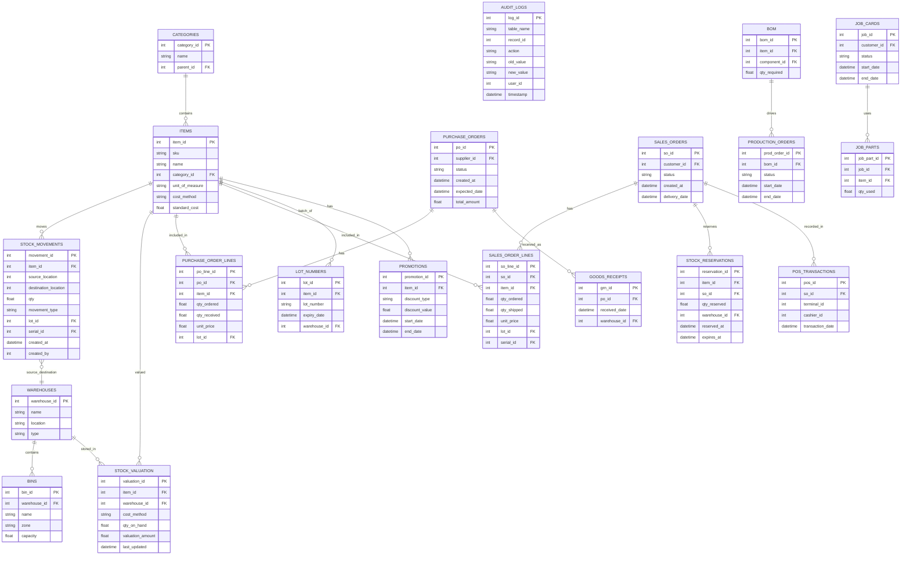

# Inventory Module Requirements Document

This will include:

- Core vs extension features
- Feature matrix by business type
- Architecture layers (core + extensions)
- Core process flows
- Comparison with Odoo, NetSuite, SAP
- Benefits & future extensions

## 📄 Inventory Module Requirements Document (Comprehensive Draft)

### 1. **Introduction**

- **Purpose**: Define a flexible, scalable, and industry-agnostic Inventory Management Module for multiple business types (`Retail`, `Wholesale`, `Manufacturing`, `Workshop`, `E-commerce`).
- **Scope**:
  - Centralized stock visibility across warehouses, locations, and channels
  - Accurate tracking of inbound, outbound, stock adjustments, and inter-warehouse transfers
  - Real-time inventory valuation and analytics
  - Integration with accounting, sales, purchasing, production, and e-commerce channels.
- **Goals**:
  - Provide modular system that can activate industry-specific features as needed.
  - Enable audit-ready stock management and compliance
  - Support enterprise-grade extensions without overcomplicating SME use

### 2. **Module Objectives**

- Accurate stock tracking across all warehouses and locations.
- Multi-level item master (`SKU`, `barcode`, `category`, `UoM`).
- Flexible costing methods (`FIFO`, `LIFO`, `Weighted Average`, `Landed Costs`).
- Core engine reusable across all industries; extensions for specific use cases.
- Scalable for both SMEs and large enterprises.

### 3. **Feature Matrix by Business Type**

| Feature Group | Core (All) | Retail | Wholesale / Distribution | Manufacturing | Workshop / Service | E-commerce / Omni-channel|
|---------------|------------|--------|--------------------------|---------------|--------------------|--------------------------|
| Item Master | ✅ SKU, barcode, categories, units | ✅ Price lists, promotions | ✅ Bulk pack sizes | ✅ BOM components | ✅ Service items + spare parts | ✅ Online item sync |
| Warehouses / Locations | ✅ Multi-warehouse, bins, zones | ✅ Branch stores | ✅ Regional warehouses | ✅ Production stores, WIP storage | ✅ Workshop store | ✅ Online channel as “virtual warehouse”|
| Stock Movements | ✅ In/Out, Transfers, Adjustments | ✅ POS auto-decrement | ✅ Bulk transfers | ✅ Raw → Finished consumption | ✅ Parts consumption | ✅ Reservation for online orders |
| Valuation / Costing | ✅ FIFO, LIFO, Avg | ✅ Promotions, discount costs | ✅ Landed cost, duty, freight | ✅ Production cost, scrap | ✅ Part + labor costing | ✅ Multi-channel price lists |
|Purchasing Integration| ✅ Stock receipts linked to POs | ✅ Auto replenish for fast items | ✅ Supplier contracts | ✅ Raw material POs | ✅ Spare part purchasing | ✅ Supplier drop-ship |
| Sales Integration | ✅ Stock issue linked to SO/invoice | ✅ POS, quick sales | ✅ Customer orders (bulk) | ✅ Finished goods delivery | ✅ Job card → invoice | ✅ Online orders API |
| Traceability | Optional | ❌ | ✅ Lot/expiry, batch | ✅ Component traceability | ✅ Warranty parts | ✅ Serial numbers for electronics |
| Replenishment / Planning | ✅ Min/max reorder | ✅ Auto restock POS | ✅ Safety stock, lead time | ✅ MRP (with BOM) | ✅ Reserve parts for jobs | ✅ Auto reserve on checkout |
| Warehouse Ops | Basic putaway/removal | ✅ Shelf/bin assignment | ✅ Bulk pallet handling | ✅ WIP storage moves | ✅ Parts stock control | ✅ Sync stock with logistics |
| Manufacturing | Optional | ❌ | ❌ | ✅ BOM, WIP, costing | ❌ | ❌ |
| Service Integration | Optional | ❌ | ❌ | ❌ | ✅ Labor + parts | ❌ |
| Omni-channel | Optional | ✅ Store + POS sync | ❌ | ❌ | ❌ | ✅ API sync with online stores |
| Reports & Analytics | ✅ Stock balances, valuation, turnover, aging | ✅ Fast/slow movers | ✅ Expiry reports, dead stock | ✅ Production costing reports | ✅ Job cost reports | ✅ Channel stock & sales |
| Compliance / Audit | ✅ Audit trail, approvals | ✅ Discounts / promo control | ✅ Expiry compliance | ✅ Production batch reports | ✅ Warranty audits | ✅ Return compliance |

### 4. **Conceptual Architecture (Core + Extensions)**

- **Core Engine**:
  - Item Master, Warehouse/Location, Stock Movements
  - Costing & Valuation, Transactions Integration, Reporting
  - Audit & Security
- **Extension Layers (Optional by Industry)**:
  - Retail: POS, Price lists, Promotions, Branch stock
  - Wholesale: Bulk handling, Lot/Batch, Landed cost, Supplier contracts
  - Manufacturing: BOM, Work Orders, Raw → Finished conversion, Scrap, WIP
  - Workshop: Job Cards, Parts + Labor, Warranty, Spare parts reservation
  - E-commerce: Real-time channel sync, API integration, Returns
- **Advanced Extensions (Cross-Layer)**:
  - Replenishment / Planning, Warehouse Ops, Traceability, Compliance, Analytics, Mobile/Scanning
- **Integration Layers**:
  - UI/UX (Web + Mobile + POS)
  - API (REST/GraphQL)
  - External Systems: Accounting, CRM, ERP, E-commerce, Shipping

### 5. **Core Process Flows**

- **Purchase → Stock In**:

```csharp
[PO Created] → [Supplier Delivers] → [GRN] → [PO vs GRN Check] → [Optional QC] → [Stock Increased] → [Valuation Updated]
```

- **Sales → Stock Out**:

```csharp
[SO Created] → [Check Stock] → [Reserve Stock] → [Pick List] → [Delivery Note] → [Stock Decreased] → [Invoice + Accounting]
```

- **Stock Transfer**

```csharp
[Transfer Request] → [Goods Issue] → [In Transit (Optional)] → [Goods Receipt] → [Update Inventory]
```

- **Stock Adjustment**

```csharp
[Adjustment Request] → [Physical Count] → [Adjustment Entry] → [Approval] → [Update Stock + Accounting]
```

- **Stock Reservation**

```csharp
[SO Created] → [Reserve Stock] → [Release on Fulfill/Cancel]
```

- **Stock Valuation & Reporting**

```csharp
[Stock Move] → [Valuation Updated] → [Reports Generated] → [Alerts Sent]
```

---

## 6. System Comparison (Odoo / NetSuite / SAP)

| Feature                | Odoo                                 | NetSuite                   | SAP                                   |
| ---------------------- | ------------------------------------ | -------------------------- | ------------------------------------- |
| Target Market          | SME → Mid-size                       | Mid → Large                | Large Enterprise                      |
| Multi-Warehouse        | ✅                                    | ✅                          | ✅                                     |
| Traceability           | Lots, Serial, Expiry                 | Lots, Serial               | Full batch/serial, compliance         |
| Manufacturing          | BOM, Work Orders                     | BOM, WIP                   | Deep MRP integration                  |
| Omni-Channel           | Limited                              | ✅                          | Middleware required                   |
| Planning & Forecasting | Basic                                | Advanced                   | Full MRP/Planning                     |
| Scalability            | SME/Medium                           | Mid/Large                  | Enterprise                            |
| Strengths              | Flexible, Modular                    | Forecasting, Multi-channel | Enterprise-grade, Compliance          |
| Weaknesses             | Advanced features require extensions | Pricey, complex            | Heavy, expensive, long implementation |

## 7. Benefits

- End-to-end inventory visibility
- Accurate valuation & audit readiness
- Modular system: activate industry-specific features
- Flexibility for SMEs and scalability for large enterprises
- Competitive advantages: combines best practices from Odoo, NetSuite, SAP

## 8. Future Extensions / Roadmap

- Retail POS integration
- Advanced Manufacturing (BOM, WIP, Shop Floor Control)
- Workshop Job Cards, Service Integration
- E-commerce API connectors (Shopify, Magento, WooCommerce)
- AI-powered demand forecasting
- Advanced Warehouse Management (Wave/Batch picking, RFID)

## 🏭 Industry-Specific Inventory Process Flows

### 1️⃣ Retail Layer (POS + Branch Stores)

```csharp
[POS Sale / Branch Order Created]
        ↓
[Check Stock Availability in Branch]
   ├──> Sufficient → Reserve Stock
   └──> Insufficient → Trigger Inter-branch Transfer or Reorder
        ↓
[Apply Promotions / Discounts]
        ↓
[Pick & Pack in Branch / POS]
        ↓
[Stock Decreased from Branch Warehouse]
        ↓
[Invoice Generated]
        ↓
[Update Central Stock (optional sync)]

```

**Additional Notes**:

- Auto-replenishment for low stock.
- Supports barcode scanning and fast checkout.

### 2️⃣ Wholesale / Distribution Layer

**Objective**: Bulk orders, multi-warehouse allocation, lot/batch tracking.
**Process Flow**:

```csharp
[Bulk Customer Order Created]
        ↓
[Allocate Stock by Warehouse / Lot / Batch]
        ↓
[Generate Picking List for Bulk Pallets / Cases]
        ↓
[Goods Picked & Packed]
        ↓
[Dispatch & Shipping]
        ↓
[Stock Decreased from Source Warehouse]
        ↓
[Update Valuation & Accounting]
```

**Additional Notes**:

- Supports expiry tracking and quality checks.
- Handles landed costs, freight, and supplier-specific pricing.

### 3️⃣ Manufacturing Layer (BOM + Production)

**Objective**: Convert raw materials to finished goods, track WIP and production costs.

**Process Flow**:

```csharp
[Production Order Created]
        ↓
[Check Raw Material Availability]
        ↓
[Reserve Raw Materials for Production]
        ↓
[Consume Raw Materials → Update Stock]
        ↓
[Track Work in Progress (WIP)]
        ↓
[Produce Finished Goods]
        ↓
[Finished Goods Stock Increased]
        ↓
[Update Production Costing & Accounting]

```

**Additional Notes**:

- Handles scrap/wastage.
- Supports multiple BOM levels (sub-assemblies).
- Can trigger replenishment for missing raw materials

### 4️⃣ Workshop / Service Layer

**Objective**: Manage parts & labor for service orders, track job cost and warranty.

**Process Flow**:

```csharp
[Job Card / Service Order Created]
        ↓
[Check Spare Parts Availability]
        ↓
[Reserve Parts for Job]
        ↓
[Consume Parts & Record Labor]
        ↓
[Complete Job & Update Stock]
        ↓
[Generate Invoice (Parts + Labor)]
        ↓
[Warranty Tracking / Returns if Applicable]
```

**Additional Notes**:

- Ensures parts are not oversold.
- Tracks warranty and returns.
- Integrates with accounting for parts/labor cost.

```csharp
[Online Order Placed]
        ↓
[Check Stock Availability Across Channels]
        ↓
[Reserve Stock for Order]
        ↓
[Pick & Pack from Warehouse]
        ↓
[Stock Decreased from Warehouse]
        ↓
[Generate Invoice & Shipping Label]
        ↓
[Update Inventory Across All Channels]
        ↓
[Handle Returns / Reverse Logistics]
```

**Additional Notes**:

- Supports multiple e-commerce platforms (Shopify, WooCommerce, Amazon, etc.)
- Prevents overselling with stock reservations.
- Automatic updates for returns/refunds.

## ✅ Summary

- Core Engine handles all **inbound/outbound, transfers, adjustments, valuation, reporting**.
- **Industry layers** extend core flows for specific needs:
  - Retail: POS, promotions, branch stock.
  - Wholesale: Bulk, lots, landed cost, multi-warehouse allocation.
  - Manufacturing: BOM, production, WIP, scrap.
  - Workshop: Job cards, parts & labor, warranty.
  - E-commerce: Online order sync, stock reservation, returns.

---

## 💾 Inventory Module Data Model

### 1️⃣ Core Engine Tables

| Table Name             | Key Columns                                                                                                                                                                  | Description                                |
| ---------------------- | ---------------------------------------------------------------------------------------------------------------------------------------------------------------------------- | ------------------------------------------ |
| `items`                | `item_id` (PK), `sku`, `name`, `category_id`, `barcode`, `unit_of_measure`, `cost_method` (FIFO/LIFO/Avg), `standard_cost`                                                   | Master data for all products.              |
| `categories`           | `category_id` (PK), `name`, `parent_id`                                                                                                                                      | Item hierarchy (for grouping & reporting). |
| `warehouses`           | `warehouse_id` (PK), `name`, `location`, `type`                                                                                                                              | Warehouses or storage locations.           |
| `bins`                 | `bin_id` (PK), `warehouse_id` (FK), `name`, `zone`, `capacity`                                                                                                               | Bin/zone within a warehouse.               |
| `stock_movements`      | `movement_id` (PK), `item_id`, `source_location`, `destination_location`, `qty`, `movement_type` (in/out/transfer/adjust), `lot_id`, `serial_id`, `created_at`, `created_by` | Logs every stock move.                     |
| `purchase_orders`      | `po_id` (PK), `supplier_id`, `status`, `created_at`, `expected_date`, `total_amount`                                                                                         | Purchase order header.                     |
| `purchase_order_lines` | `po_line_id` (PK), `po_id` (FK), `item_id`, `qty_ordered`, `qty_received`, `unit_price`, `lot_id`                                                                            | Line items of POs.                         |
| `goods_receipts`       | `grn_id` (PK), `po_id` (FK), `received_date`, `warehouse_id`                                                                                                                 | Goods Receipt Notes.                       |
| `sales_orders`         | `so_id` (PK), `customer_id`, `status`, `created_at`, `delivery_date`                                                                                                         | Sales order header.                        |
| `sales_order_lines`    | `so_line_id` (PK), `so_id` (FK), `item_id`, `qty_ordered`, `qty_shipped`, `unit_price`, `lot_id`, `serial_id`                                                                | Line items of Sales Orders.                |
| `stock_valuation`      | `valuation_id` (PK), `item_id`, `warehouse_id`, `cost_method`, `qty_on_hand`, `valuation_amount`, `last_updated`                                                             | Tracks real-time stock value.              |
| `audit_logs`           | `log_id` (PK), `table_name`, `record_id`, `action`, `old_value`, `new_value`, `user_id`, `timestamp`                                                                         | Tracks all critical changes.               |
| `stock_reservations`   | `reservation_id` (PK), `item_id`, `so_id` (FK), `qty_reserved`, `warehouse_id`, `reserved_at`, `expires_at`                                                                  | Tracks reserved stock for orders.          |

### 2️⃣ Industry-Specific Tables

- 🔹 **Retail**

| Table Name         | Key Columns                                                                                 | Description                 |
| ------------------ | ------------------------------------------------------------------------------------------- | --------------------------- |
| `pos_transactions` | `pos_id` (PK), `so_id` (FK), `terminal_id`, `cashier_id`, `transaction_date`                | Point-of-sale transactions. |
| `promotions`       | `promotion_id` (PK), `item_id`, `discount_type`, `discount_value`, `start_date`, `end_date` | Store/branch promotions.    |
| `branch_stock`     | `branch_id`, `item_id`, `qty_on_hand`, `reserved_qty`                                       | Real-time stock per branch. |

- 🔹 **Wholesale / Distribution**

| Table Name      | Key Columns                                                           | Description             |
| --------------- | --------------------------------------------------------------------- | ----------------------- |
| `bulk_packs`    | `bulk_id` (PK), `item_id`, `pack_type` (pallet/case), `qty_per_pack`  | Bulk packaging info.    |
| `lot_numbers`   | `lot_id` (PK), `item_id`, `lot_number`, `expiry_date`, `warehouse_id` | Lot/batch tracking.     |
| `freight_costs` | `freight_id` (PK), `po_id` (FK), `cost_type`, `amount`                | Landed cost components. |

- 🔹 **Manufacturing**

| Table Name          | Key Columns                                                               | Description                |
| ------------------- | ------------------------------------------------------------------------- | -------------------------- |
| `bom`               | `bom_id` (PK), `item_id` (finished\_good), `component_id`, `qty_required` | Bill of Materials.         |
| `production_orders` | `prod_order_id` (PK), `bom_id` (FK), `status`, `start_date`, `end_date`   | Work orders.               |
| `wip_stock`         | `wip_id` (PK), `prod_order_id` (FK), `item_id`, `qty_in_process`          | Work-in-progress tracking. |
| `scrap_log`         | `scrap_id` (PK), `prod_order_id`, `item_id`, `qty_scrapped`, `reason`     | Scrap/wastage recording.   |

- 🔹 **Workshop / Service**

| Table Name     | Key Columns                                                           | Description                 |
| -------------- | --------------------------------------------------------------------- | --------------------------- |
| `job_cards`    | `job_id` (PK), `customer_id`, `status`, `start_date`, `end_date`      | Service job tracking.       |
| `job_parts`    | `job_part_id` (PK), `job_id` (FK), `item_id`, `qty_used`              | Parts used in service jobs. |
| `job_labor`    | `job_labor_id` (PK), `job_id` (FK), `employee_id`, `hours`, `rate`    | Labor cost tracking.        |
| `warranty_log` | `warranty_id` (PK), `item_id`, `customer_id`, `job_id`, `expiry_date` | Warranty tracking.          |

- 🔹 **E-commerce / Omni-channel**

| Table Name       | Key Columns                                                           | Description                       |
| ---------------- | --------------------------------------------------------------------- | --------------------------------- |
| `channel_orders` | `channel_order_id` (PK), `so_id` (FK), `channel_name`, `order_status` | Online store orders.              |
| `channel_stock`  | `item_id`, `channel_name`, `qty_available`, `reserved_qty`            | Real-time stock sync per channel. |
| `returns_log`    | `return_id` (PK), `so_id`, `item_id`, `qty_returned`, `return_reason` | Returns / reverse logistics.      |

### 3️⃣ Relationships / Notes

- `items` → `stock_movements`, `sales_order_lines`, `purchase_order_lines`, `lot_numbers`
- `warehouses` → `bins`, `stock_movements`, `stock_valuation`
- `sales_orders` → `sales_order_lines`, `stock_reservations`, `channel_orders`
- `purchase_orders` → `purchase_order_lines`, `goods_receipts`, `freight_costs`
- Industry-specific tables are linked to core tables to maintain consistency.
- All transactions update `stock_valuation` and `audit_logs`.

---

## 🗂️ Inventory Module ER Diagram (Textual Layout)

### 1. Inventory Module ER Diagram in Mermaid syntax


### ✅ Key Notes

- **Core tables**: `items`, `warehouses`, `bins`, `stock_movements`, `stock_valuation`, `purchase_orders`, `sales_orders`, `stock_reservations`, `audit_logs`.
- **Industry-specific tables**: linked to `items`, `warehouses`, `sales_orders`, `purchase_orders` as appropriate.
- **Relationships**:
  - `items` → all movement, valuation, sales, purchase, and extension tables.
  - `warehouses` → `bins`, stock movements, valuations.
  - `sales_orders` & `purchase_orders` → lines, reservations, GRNs, channel orders.
- **Audit & logs** table tracks all critical changes for compliance.

---

### 2. Inventory Module ER Diagram in Mermaid syntax



### ✅ Notes on this Mermaid ER Diagram:

- **Core tables**: `items`, `warehouses`, `bins`, `stock_movements`, `stock_valuation`, `purchase_orders`, `sales_orders`, `stock_reservations`, `audit_logs`.
- **Industry-specific examples**: POS, Promotions, Lot Numbers, BOM, Production Orders, Job Cards & Parts.
- **Relationships**:
  - `items` is central, connected to almost all tables.
  - `warehouses` connect to `bins`, `stock_movements`, `stock_valuation`.
  - Industry-specific tables connect back to core (`items`, `sales_orders`, `purchase_orders`).

---

### 3. full, comprehensive Mermaid ER diagram for the Inventory Module, covering Core + all Industry-Specific tables

```mermaid
erDiagram
    %% Core Tables
    CATEGORIES {
        int category_id PK
        string name
        int parent_id FK
    }
    ITEMS {
        int item_id PK
        string sku
        string name
        int category_id FK
        string unit_of_measure
        string cost_method
        float standard_cost
    }
    WAREHOUSES {
        int warehouse_id PK
        string name
        string location
        string type
    }
    BINS {
        int bin_id PK
        int warehouse_id FK
        string name
        string zone
        float capacity
    }
    STOCK_MOVEMENTS {
        int movement_id PK
        int item_id FK
        int source_location
        int destination_location
        float qty
        string movement_type
        int lot_id FK
        int serial_id FK
        datetime created_at
        int created_by
    }
    STOCK_VALUATION {
        int valuation_id PK
        int item_id FK
        int warehouse_id FK
        string cost_method
        float qty_on_hand
        float valuation_amount
        datetime last_updated
    }
    PURCHASE_ORDERS {
        int po_id PK
        int supplier_id FK
        string status
        datetime created_at
        datetime expected_date
        float total_amount
    }
    PURCHASE_ORDER_LINES {
        int po_line_id PK
        int po_id FK
        int item_id FK
        float qty_ordered
        float qty_received
        float unit_price
        int lot_id FK
    }
    GOODS_RECEIPTS {
        int grn_id PK
        int po_id FK
        datetime received_date
        int warehouse_id FK
    }
    SALES_ORDERS {
        int so_id PK
        int customer_id FK
        string status
        datetime created_at
        datetime delivery_date
    }
    SALES_ORDER_LINES {
        int so_line_id PK
        int so_id FK
        int item_id FK
        float qty_ordered
        float qty_shipped
        float unit_price
        int lot_id FK
        int serial_id FK
    }
    STOCK_RESERVATIONS {
        int reservation_id PK
        int item_id FK
        int so_id FK
        float qty_reserved
        int warehouse_id FK
        datetime reserved_at
        datetime expires_at
    }
    AUDIT_LOGS {
        int log_id PK
        string table_name
        int record_id
        string action
        string old_value
        string new_value
        int user_id
        datetime timestamp
    }

    %% Retail Tables
    POS_TRANSACTIONS {
        int pos_id PK
        int so_id FK
        int terminal_id
        int cashier_id
        datetime transaction_date
    }
    PROMOTIONS {
        int promotion_id PK
        int item_id FK
        string discount_type
        float discount_value
        datetime start_date
        datetime end_date
    }
    BRANCH_STOCK {
        int branch_id PK
        int item_id FK
        float qty_on_hand
        float reserved_qty
    }

    %% Wholesale Tables
    LOT_NUMBERS {
        int lot_id PK
        int item_id FK
        string lot_number
        datetime expiry_date
        int warehouse_id FK
    }
    BULK_PACKS {
        int bulk_id PK
        int item_id FK
        string pack_type
        float qty_per_pack
    }
    FREIGHT_COSTS {
        int freight_id PK
        int po_id FK
        string cost_type
        float amount
    }

    %% Manufacturing Tables
    BOM {
        int bom_id PK
        int item_id FK
        int component_id FK
        float qty_required
    }
    PRODUCTION_ORDERS {
        int prod_order_id PK
        int bom_id FK
        string status
        datetime start_date
        datetime end_date
    }
    WIP_STOCK {
        int wip_id PK
        int prod_order_id FK
        int item_id FK
        float qty_in_process
    }
    SCRAP_LOG {
        int scrap_id PK
        int prod_order_id FK
        int item_id FK
        float qty_scrapped
        string reason
    }

    %% Workshop / Service Tables
    JOB_CARDS {
        int job_id PK
        int customer_id FK
        string status
        datetime start_date
        datetime end_date
    }
    JOB_PARTS {
        int job_part_id PK
        int job_id FK
        int item_id FK
        float qty_used
    }
    JOB_LABOR {
        int job_labor_id PK
        int job_id FK
        int employee_id
        float hours
        float rate
    }
    WARRANTY_LOG {
        int warranty_id PK
        int item_id FK
        int customer_id FK
        int job_id FK
        datetime expiry_date
    }

    %% E-commerce / Omni-channel Tables
    CHANNEL_ORDERS {
        int channel_order_id PK
        int so_id FK
        string channel_name
        string order_status
    }
    CHANNEL_STOCK {
        int item_id PK
        string channel_name PK
        float qty_available
        float reserved_qty
    }
    RETURNS_LOG {
        int return_id PK
        int so_id FK
        int item_id FK
        float qty_returned
        string return_reason
    }

    %% Relationships
    CATEGORIES ||--o{ ITEMS : contains
    ITEMS ||--o{ STOCK_MOVEMENTS : moves
    ITEMS ||--o{ STOCK_VALUATION : valued
    ITEMS ||--o{ PURCHASE_ORDER_LINES : included_in
    ITEMS ||--o{ SALES_ORDER_LINES : included_in
    ITEMS ||--o{ LOT_NUMBERS : batch_of
    ITEMS ||--o{ PROMOTIONS : has
    ITEMS ||--o{ BRANCH_STOCK : stored_in
    ITEMS ||--o{ JOB_PARTS : used_in
    ITEMS ||--o{ WARRANTY_LOG : covered_by
    ITEMS ||--o{ CHANNEL_STOCK : available_in
    WAREHOUSES ||--o{ BINS : contains
    WAREHOUSES ||--o{ STOCK_VALUATION : stored_in
    STOCK_MOVEMENTS }o--|| WAREHOUSES : source_destination
    PURCHASE_ORDERS ||--o{ PURCHASE_ORDER_LINES : has
    PURCHASE_ORDERS ||--o{ GOODS_RECEIPTS : received_as
    PURCHASE_ORDERS ||--o{ FREIGHT_COSTS : includes
    SALES_ORDERS ||--o{ SALES_ORDER_LINES : has
    SALES_ORDERS ||--o{ STOCK_RESERVATIONS : reserves
    SALES_ORDERS ||--o{ POS_TRANSACTIONS : recorded_in
    SALES_ORDERS ||--o{ CHANNEL_ORDERS : synced_with
    JOB_CARDS ||--o{ JOB_PARTS : uses
    JOB_CARDS ||--o{ JOB_LABOR : includes
    BOM ||--o{ PRODUCTION_ORDERS : drives
    PRODUCTION_ORDERS ||--o{ WIP_STOCK : contains
    PRODUCTION_ORDERS ||--o{ SCRAP_LOG : tracks

```



### ✅ Features of this Mermaid ER Diagram:

- Includes all Core tables (`items`, `warehouses`, `bins`, `stock_movements`, `stock_valuation`, `purchase_orders`, `sales_orders`, `stock_reservations`, `audit_logs`).
- Covers all Industry-Specific tables (Retail, Wholesale, Manufacturing, Workshop, E-commerce).
- Shows key relationships clearly: FK links, containment, usage.
- Ready to render in Mermaid-compatible tools for developers.

### 4 color-coded, layered Mermaid ER diagram

**Core, Retail, Wholesale, Manufacturing, Workshop, and E-commerce layers**:

```mermaid
erDiagram
    %% Core Layer
    subgraph Core [Core Engine]
        CATEGORIES {
            int category_id PK
            string name
            int parent_id FK
        }
        ITEMS {
            int item_id PK
            string sku
            string name
            int category_id FK
            string unit_of_measure
            string cost_method
            float standard_cost
        }
        WAREHOUSES {
            int warehouse_id PK
            string name
            string location
            string type
        }
        BINS {
            int bin_id PK
            int warehouse_id FK
            string name
            string zone
            float capacity
        }
        STOCK_MOVEMENTS {
            int movement_id PK
            int item_id FK
            int source_location
            int destination_location
            float qty
            string movement_type
            int lot_id FK
            int serial_id FK
            datetime created_at
            int created_by
        }
        STOCK_VALUATION {
            int valuation_id PK
            int item_id FK
            int warehouse_id FK
            string cost_method
            float qty_on_hand
            float valuation_amount
            datetime last_updated
        }
        PURCHASE_ORDERS {
            int po_id PK
            int supplier_id FK
            string status
            datetime created_at
            datetime expected_date
            float total_amount
        }
        PURCHASE_ORDER_LINES {
            int po_line_id PK
            int po_id FK
            int item_id FK
            float qty_ordered
            float qty_received
            float unit_price
            int lot_id FK
        }
        GOODS_RECEIPTS {
            int grn_id PK
            int po_id FK
            datetime received_date
            int warehouse_id FK
        }
        SALES_ORDERS {
            int so_id PK
            int customer_id FK
            string status
            datetime created_at
            datetime delivery_date
        }
        SALES_ORDER_LINES {
            int so_line_id PK
            int so_id FK
            int item_id FK
            float qty_ordered
            float qty_shipped
            float unit_price
            int lot_id FK
            int serial_id FK
        }
        STOCK_RESERVATIONS {
            int reservation_id PK
            int item_id FK
            int so_id FK
            float qty_reserved
            int warehouse_id FK
            datetime reserved_at
            datetime expires_at
        }
        AUDIT_LOGS {
            int log_id PK
            string table_name
            int record_id
            string action
            string old_value
            string new_value
            int user_id
            datetime timestamp
        }
    end

    %% Retail Layer
    subgraph Retail [Retail Layer]
        POS_TRANSACTIONS {
            int pos_id PK
            int so_id FK
            int terminal_id
            int cashier_id
            datetime transaction_date
        }
        PROMOTIONS {
            int promotion_id PK
            int item_id FK
            string discount_type
            float discount_value
            datetime start_date
            datetime end_date
        }
        BRANCH_STOCK {
            int branch_id PK
            int item_id FK
            float qty_on_hand
            float reserved_qty
        }
    end

    %% Wholesale Layer
    subgraph Wholesale [Wholesale / Distribution]
        LOT_NUMBERS {
            int lot_id PK
            int item_id FK
            string lot_number
            datetime expiry_date
            int warehouse_id FK
        }
        BULK_PACKS {
            int bulk_id PK
            int item_id FK
            string pack_type
            float qty_per_pack
        }
        FREIGHT_COSTS {
            int freight_id PK
            int po_id FK
            string cost_type
            float amount
        }
    end

    %% Manufacturing Layer
    subgraph Manufacturing [Manufacturing Layer]
        BOM {
            int bom_id PK
            int item_id FK
            int component_id FK
            float qty_required
        }
        PRODUCTION_ORDERS {
            int prod_order_id PK
            int bom_id FK
            string status
            datetime start_date
            datetime end_date
        }
        WIP_STOCK {
            int wip_id PK
            int prod_order_id FK
            int item_id FK
            float qty_in_process
        }
        SCRAP_LOG {
            int scrap_id PK
            int prod_order_id FK
            int item_id FK
            float qty_scrapped
            string reason
        }
    end

    %% Workshop Layer
    subgraph Workshop [Workshop / Service Layer]
        JOB_CARDS {
            int job_id PK
            int customer_id FK
            string status
            datetime start_date
            datetime end_date
        }
        JOB_PARTS {
            int job_part_id PK
            int job_id FK
            int item_id FK
            float qty_used
        }
        JOB_LABOR {
            int job_labor_id PK
            int job_id FK
            int employee_id
            float hours
            float rate
        }
        WARRANTY_LOG {
            int warranty_id PK
            int item_id FK
            int customer_id FK
            int job_id FK
            datetime expiry_date
        }
    end

    %% E-commerce Layer
    subgraph Ecommerce [E-commerce / Omni-channel]
        CHANNEL_ORDERS {
            int channel_order_id PK
            int so_id FK
            string channel_name
            string order_status
        }
        CHANNEL_STOCK {
            int item_id PK
            string channel_name PK
            float qty_available
            float reserved_qty
        }
        RETURNS_LOG {
            int return_id PK
            int so_id FK
            int item_id FK
            float qty_returned
            string return_reason
        }
    end

    %% Relationships
    CATEGORIES ||--o{ ITEMS : contains
    ITEMS ||--o{ STOCK_MOVEMENTS : moves
    ITEMS ||--o{ STOCK_VALUATION : valued
    ITEMS ||--o{ PURCHASE_ORDER_LINES : included_in
    ITEMS ||--o{ SALES_ORDER_LINES : included_in
    ITEMS ||--o{ LOT_NUMBERS : batch_of
    ITEMS ||--o{ PROMOTIONS : has
    ITEMS ||--o{ BRANCH_STOCK : stored_in
    ITEMS ||--o{ JOB_PARTS : used_in
    ITEMS ||--o{ WARRANTY_LOG : covered_by
    ITEMS ||--o{ CHANNEL_STOCK : available_in

    WAREHOUSES ||--o{ BINS : contains
    WAREHOUSES ||--o{ STOCK_VALUATION : stored_in
    STOCK_MOVEMENTS }o--|| WAREHOUSES : source_destination

    PURCHASE_ORDERS ||--o{ PURCHASE_ORDER_LINES : has
    PURCHASE_ORDERS ||--o{ GOODS_RECEIPTS : received_as
    PURCHASE_ORDERS ||--o{ FREIGHT_COSTS : includes

    SALES_ORDERS ||--o{ SALES_ORDER_LINES : has
    SALES_ORDERS ||--o{ STOCK_RESERVATIONS : reserves
    SALES_ORDERS ||--o{ POS_TRANSACTIONS : recorded_in
    SALES_ORDERS ||--o{ CHANNEL_ORDERS : synced_with

    JOB_CARDS ||--o{ JOB_PARTS : uses
    JOB_CARDS ||--o{ JOB_LABOR : includes

    BOM ||--o{ PRODUCTION_ORDERS : drives
    PRODUCTION_ORDERS ||--o{ WIP_STOCK : contains
    PRODUCTION_ORDERS ||--o{ SCRAP_LOG : tracks

```

### ✅ Features of this Layered Mermaid Diagram:

- **Subgraphs** clearly separate **Core**, **Retail**, **Wholesale**, **Manufacturing**, **Workshop**, and **E-commerce** layers.
- Easier for **developers and architects** to read.
- Maintains all **relationships and keys**.
- Can be rendered in **Mermaid-compatible editors** **with color-coded subgraphs**.
