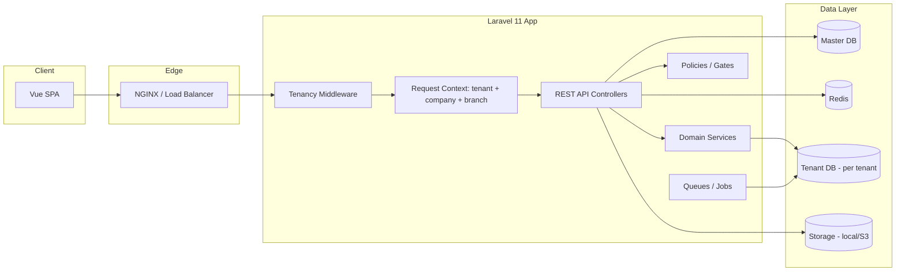

# Multi‑Tenant ERP (Laravel 11 + Vue 3) — Prerequisites & System Architecture

**One‑liner:** Scalable, multi‑tenant ERP on Laravel 11 with per‑tenant databases, company/branch hierarchy, shared auth and granular reporting across branches.

---

## 1) Scope & Goals

- **Scope (backend‑first):** Tenant provisioning, authentication/authorization, Companies module, Branches module, finance setup scaffolding (Chart of Accounts and Number Sequences at **company** level), and reporting filters by branch (single/multi/all as permission allows).
- **Primary goals:**
  - Strong data isolation via **per‑tenant database** design.
  - License model that lets a single tenant (customer account) operate **multiple companies**, each with **multiple branches**.
  - Company‑level **Chart of Accounts** (COA) and **Number Sequences**; branches **share** company COA/sequences.
  - Permissions that allow **branch‑scoped** actions and **aggregate** (multi‑branch) reporting when allowed.
- **Non‑goals (Phase 0):** Business processes (sales, purchase, inventory, etc.), external integrations, advanced analytics, complex workflow engine. These will follow later phases.

---

## 2) Terminology

- **Tenant:** A customer account (e.g., “Group X”) with its **own database**. A tenant can hold multiple **companies**.
- **Company:** Legal entity under a tenant (e.g., “Company Y”, “Company Z”). Has its own **COA** and **Number Sequences**.
- **Branch:** Operating location of a company (e.g., main, Riyadh, Jeddah). Shares the company’s **VAT**, COA, and sequences unless explicitly overridden by policy.
- **License:** Commercial limits and entitlements for a tenant (max companies, max branches per company, enabled modules).
- **User:** Authenticated person (per tenant) with roles/permissions, optional branch access restrictions for operations and reporting.

---

## 3) Target Stack & Prerequisites

### Runtime & OS
- **PHP:** 8.3+
- **Laravel:** 11.x
- **Database:** PostgreSQL 15/16 (recommended for schemas, JSONB, CTEs) or MySQL 8.0+
- **Cache/Queue:** Redis 7+
- **Node.js:** 20+ with **Vite** build tooling (for Vue SPA)
- **Package managers:** Composer 2.7+, npm/pnpm/yarn
- **Optional:** Docker (Sail) for local dev parity; Supervisor or systemd for queue workers

### Laravel Components (suggested)
- **Auth for SPA:** Laravel **Sanctum** (token/cookie based) for Vue front‑end
- **Queues:** Laravel Queue + **Horizon** for monitoring
- **Migrations:** Separate paths for **master** and **tenant** migrations
- **Validation/Docs:** Request validation + OpenAPI (e.g., L5‑Swagger) for API docs
- **Logging/Audit:** Monolog in JSON to file/stdout + audit tables per tenant
- **File storage:** Local/S3 via Flysystem

### Front‑end (high level, later)
- **Vue 3**, **TypeScript**, **Pinia**, **Vue Router**, **Vite**; SSR not required initially

---

## 4) Multi‑Tenancy Strategy

### 4.1 Model
- **Master database:** Global registry of tenants, licenses, and domains. No tenant business data here.
- **One database per tenant:** Strong isolation, independent backups/restores, safer GDPR/customer separation.
- **Tenant identification:** By **subdomain** (e.g., `x.example.com`) or **domain alias** per tenant. A middleware resolves the tenant and switches DB connection dynamically.

### 4.2 Data Separation
- **Master DB:** `tenants`, `tenant_domains`, `licenses`, `users_master` (optional; see auth model below).
- **Tenant DB:** All business tables (`companies`, `branches`, `coa_accounts`, `number_sequences`, `users`, `roles`, `permissions`, `audits`, etc.).

### 4.3 Migrations & Seeding
- Keep **two migration trees**:
  - `database/migrations_master/*` for master
  - `database/migrations_tenant/*` for tenant
- Provisioning flow creates the tenant DB, runs tenant migrations/seeds, and registers domains and license in master.

---

## 5) Licensing Model (Master DB)

- **licenses**: `{ tenant_id, plan_code, max_companies, max_branches_per_company, features_json, starts_at, ends_at, status }`
- Enforced at creation time (company/branch create) and periodically (scheduled job). Soft enforcement rules can warn when near limits.

---

## 6) AuthN/AuthZ & Permissions

- **Auth (SPA):** Laravel **Sanctum**. Issue tokens/cookies scoped to tenant.
- **User storage:** **Per tenant DB** (default). Optionally enable **master SSO** if cross‑tenant access is needed later.
- **Roles & Permissions:** Tenant‑local tables: `roles`, `permissions`, `role_permissions`, `user_roles`.
- **Branch access:** Users can be assigned:
  - **All branches** of a company, or
  - **Specific branches** only (via pivot `user_branches`), controlling read/write/report scope.
- **Reporting permissions:**
  - `report.branch.view` (single)
  - `report.branch.multi` (select many)
  - `report.branch.all` (aggregate over all branches in allowed companies)

---

## 7) Domain Model (Tenant DB)

### 7.1 Companies
- Legal data: `name`, `cr_number`, `cr_issue_date`, **multiple registrations** (VAT, tax, activity codes) via child table `company_registrations`.
- Finance setup: **COA** and **Number Sequences** belong to **company**.
- A company has **many branches**.

### 7.2 Branches
- Belong to a **company**; inherit **VAT** and most regulatory data from the company (unless policy allows override for identifiers like address).
- Operate on the company’s **COA** and **Number Sequences**.
- Used as a primary filter in UI and reporting.

### 7.3 Finance Setup (foundational)
- **coa_accounts**: hierarchical, company‑scoped.
- **number_sequences**: company‑scoped; series codes per document type; branches reuse these sequences.

### 7.4 Auditing
- `audit_log` with `actor_user_id`, `company_id`, `branch_id`, action, payload diff, request metadata.

---

## 8) Reporting Model

- Every business row carries `company_id` and **optional** `branch_id` where applicable.
- Reports accept filters: **company**, **branch list**, **date range**; permission checks decide whether the user may select **multiple** or **all** branches.
- Aggregations run at the **company** level by default; branch roll‑ups are sum of child branches.

---

## 9) High‑Level Architecture (Backend)



---

## 10) Core Entities (ER Overview)

```mermaid
erDiagram
    TENANT ||--o{ TENANT_DOMAIN : owns
    TENANT ||--o{ LICENSE : has

    COMPANY ||--o{ BRANCH : has
    COMPANY ||--o{ COA_ACCOUNT : contains
    COMPANY ||--o{ NUMBER_SEQUENCE : uses

    USER ||--o{ USER_ROLE : has
    ROLE ||--o{ USER_ROLE : includes
    ROLE ||--o{ ROLE_PERMISSION : maps
    PERMISSION ||--o{ ROLE_PERMISSION : grants

    %% Key attributes
    TENANT {
      uuid id
      string name
      string slug
    }
    LICENSE {
      uuid id
      uuid tenant_id
      string plan_code
      int max_companies
      int max_branches_per_company
      json features_json
      timestamp starts_at
      timestamp ends_at
      string status
    }
    COMPANY {
      uuid id
      uuid tenant_id
      string name
      string cr_number
      date cr_issue_date
    }
    COMPANY_REGISTRATION {
      uuid id
      uuid company_id
      string type  %% e.g. VAT, Tax, Activity
      string value
      date   issue_date
    }
    BRANCH {
      uuid id
      uuid company_id
      string name
      string code
      string city
      string is_main  %% boolean
    }
    COA_ACCOUNT {
      uuid id
      uuid company_id
      string code
      string name
      uuid parent_id
      string type  %% asset, liability, equity, income, expense
      bool is_posting
    }
    NUMBER_SEQUENCE {
      uuid id
      uuid company_id
      string doc_type  %% e.g. JE, INV, PO
      string prefix
      int next_number
      int padding
      bool yearly_reset
    }
    USER {
      uuid id
      uuid tenant_id
      string name
      string email
      bool   active
    }
    USER_BRANCH {
      uuid id
      uuid user_id
      uuid branch_id
    }
```

> **Note:** `COMPANY_REGISTRATION` is child of `COMPANY` (one‑to‑many) to store multiple identifiers (VAT, CR, activities) with issue dates.

---

## 11) Tenant Resolution & Request Context

- **Tenant resolver middleware** determines tenant from host (or header) and switches the DB connection.
- A lightweight **Request Context** (in container) holds `{ tenant_id, user_id, company_id (optional), branch_ids (list) }`.
- Policies read this context to enforce access to single, multiple, or all branches.

---

## 12) API Surface (Phase 0/1 – outline only)

- `/auth/*` — login, logout, user profile, tokens
- `/tenancy/*` — create tenant, attach domain, license CRUD (admin‑only, master context)
- `/companies/*` — CRUD companies, registrations, assign COA/sequences
- `/branches/*` — CRUD branches, link to company
- `/reports/*` — basic list/summary endpoints with company/branch filters

> Strict request validation, resource policies, and pagination by default.

---

## 13) Operational Concerns

- **Backups:** Per‑tenant DB backups; restore flows limited to tenant scope.
- **Migrations:** Run master migrations first; for each tenant, run tenant migrations in a controlled job (serializable lock).
- **Observability:** Structured logs, audit trails, and queued notifications on critical events (e.g., license expiry warning).
- **Security:** HTTPS everywhere, rotated tokens, per‑tenant encryption keys (optional at rest), minimal PII in logs.
- **Performance:** Redis for cache/sessions/queues; DB connections pooled; heavy reports async where possible.

---

## 14) Phase Plan

- **Phase 0 (today):** Project skeleton; master/tenant migrations; first tenant creation; Sanctum; simple Companies & Branches; basic reporting filters.
- **Phase 1:** Audit logging; licenses enforcement; COA + sequences UI hooks; role/permission matrix; Horizon + metrics.
- **Phase 2:** Import/export tools; configurable number series; branch‑level warehouse/workflow hooks.
- **Phase 3:** Full finance and inventory modules; advanced workflow; cross‑company consolidation reporting.

---

## 15) Acceptance Checklist (for this milestone)

- [ ] Master DB with `tenants`, `tenant_domains`, `licenses`
- [ ] Tenant provisioning command and API
- [ ] Tenant DB migrations (companies, company_registrations, branches, users, roles, permissions, COA, number_sequences, audit_log)
- [ ] Sanctum auth working end‑to‑end
- [ ] Roles/permissions with branch scoping
- [ ] Companies & Branches CRUD with validation
- [ ] Reporting endpoints accept company + multi‑branch filters

---

## 16) Quick Story Examples

- **As a finance manager**, I can query “all branches” for company **Y** to produce a monthly summary because I have `report.branch.all`.
- **As a branch accountant**, I can only create and view documents for my assigned branch list.
- **As a tenant admin**, I can add companies and branches until the license limits are reached.

---

## 17) Risks & Mitigations

- **Migration drift per tenant:** Use versioned migration runner and central registry of tenant schema version.
- **Cross‑tenant leakage:** Enforce connection scoping in middleware and repository layer; integration tests to prove isolation.
- **License edge cases:** Grace windows and clear UX for over‑limit operations.
- **Reporting performance:** Pre‑aggregations and async exports for large branch sets.

---
💰 FINANCIAL REPORTS ONLY (You Have All Data For These)
1. Trial Balance 🧮
Why: Validates your entire accounting system
Data Source: Chart of Accounts + Journal Entries
Shows: All account balances, proves debit = credit

2. General Ledger 📋
Why: Complete transaction history
Data Source: Journal Entries + Journal Entry Rows
Shows: Every debit/credit across all accounts

3. Balance Sheet 📊
Why: Financial position snapshot
Data Source: COA (balance sheet accounts) + Journal Entries
Shows: Assets = Liabilities + Equity

4. Income Statement (P&L) 💵
Why: Revenue vs Expenses performance
Data Source: COA (income statement accounts) + Journal Entries
Shows: Revenue - Expenses = Net Income

5. Journal Entries Report 📝
Why: Audit all accounting entries
Data Source: Journal Entries table
Shows: Entry details, status, dates, creators

6. Account Ledger 🔍
Why: Drill into specific account activity
Data Source: Single account from COA + its journal rows
Shows: All transactions for one account

 REPORTS TO SKIP FOR NOW (Need Inventory/Sales Modules)
❌ Vehicle Sales Report

❌ Parts Sales Report

❌ Service Revenue Report

❌ Inventory Status

❌ Cost of Goods Sold

❌ Gross Profit Margin
**End of document.**
